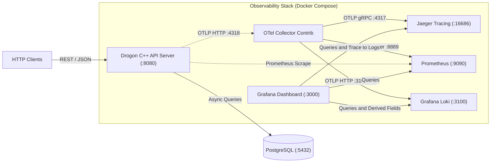

# Drogon C++ API Starter with Full OpenTelemetry Setup

A production-ready, modern **C++20** REST API starter template built with the **Drogon** web framework, **RapidJSON**, and **PostgreSQL**, pre-configured with a complete **OpenTelemetry (OTel)** observability stack (**OTel Collector**, **Jaeger**, **Prometheus**, **Loki**, and **Grafana**), bidirectional SQL migrations, and interactive **Swagger UI / OpenAPI 3.0** documentation.

---

## ⚡ Highlights & Key Features

- **Drogon Web Framework**:
   - Ranked #1 for C++ frameworks in the TechEmpower benchmarks.
   - Built on a non-blocking asynchronous event loop (IOCP on Windows, epoll on Linux, kqueue on macOS) via Trantor.
   - Zero-copy HTTP pipeline and multi-threaded event polling mapped to hardware concurrency.
- **RapidJSON Serialization**:
   - SIMD-accelerated (SSE4.2/AVX) JSON parser and generator.
   - In-place parsing and streaming serialization directly into response buffers without intermediate string allocations.
- **Full OpenTelemetry (OTel) Telemetry Pipeline**:
  - **Distributed Tracing (Spans)**: W3C TraceContext (`traceparent`) parsing and propagation across all HTTP requests and responses.
  - **Database Child Spans**: Latency and query tracking for PostgreSQL operations in [`DatabaseManager`](src/db/DatabaseManager.cpp).
  - **Dual-Mode Metrics**: Atomic request counters and latency histograms exported over OTLP to the OTel Collector and scraped directly by Prometheus at [`/api/v1/metrics`](src/controllers/MetricsController.cpp).
  - **Trace-Correlated Logs**: Application and Drogon logs automatically capture active `trace_id` and `span_id` for instant trace-to-log correlation in Grafana and Jaeger.
  - **Asynchronous OTLP Batch Exporter**: Non-blocking background worker flushes batches over HTTP (`/v1/traces`, `/v1/metrics`, `/v1/logs`) without blocking request threads.
- **Swagger UI & OpenAPI 3.0**:
  - Swagger documentation at `/docs` (or `/swagger`) with live "Try it out" execution and OpenAPI 3.0 specification at `/api/v1/openapi.json`.
- **Bidirectional Database Migrations**:
  - Incremental `*.up.sql` and `*.down.sql` migrations executed within database transactions and tracked via `schema_migrations`.
- **Single Source of Truth Configuration**:
  - Centralized runtime settings in [`config.json`](config.json) for listeners, threads, connection pooling, and OpenTelemetry.

---

## 🏛️ Observability Architecture



---

## 📁 Project Structure

```text
├── config.json              # App, PostgreSQL, and OpenTelemetry configuration
├── docker-compose.yml       # PostgreSQL + Observability stack (OTel, Jaeger, Prom, Loki, Grafana)
├── Makefile                 # Shortcuts (make db, make migrate-up, make dev, make test, make obs)
├── CMakeLists.txt           # Modern C++20 build definition & vcpkg toolchain
├── docs/                    # OpenAPI 3.0.3 specification (openapi.json)
├── migrations/              # Transactional *.up.sql and *.down.sql schema migrations
├── observability/           # OTel Collector, Prometheus, Loki, and Grafana provisioning
├── include/api/             # Header files (controllers, models, services, db, otel)
├── src/                     # Implementation files (controllers, services, db, otel, main.cpp)
├── scripts/                 # Automation scripts (start-db, migrate, test-api, build)
└── tests/                   # Unit test suite (RapidJSON, W3C TraceContext, OTel metrics)
```

---

## 🛠️ Prerequisites

Ensure the following tools are installed and available in your system's `PATH`:

1. **C++20 Compiler & CMake**:
   - Visual Studio 2022 MSVC (Windows), GCC 11+, or Clang 13+.
   - CMake 3.22+ (`cmake` in `PATH`).
2. **vcpkg Package Manager**:
   - `vcpkg` in `PATH` (or set `VCPKG_ROOT` environment variable).
   - Install dependencies:
     ```bash
     vcpkg install drogon[postgres,orm] rapidjson
     ```
3. **Docker & Docker Compose**:
   - Docker daemon running (`docker` and `docker compose` in `PATH`).
4. **GNU Make** *(Optional)*:
   - For running standard `make` shortcut commands (`choco install make` on Windows, or via your package manager).

---

## 🚀 Quick Start Guide

Follow these steps to launch the entire stack:

### 1. Start Database & Observability Stack
```bash
docker compose up -d
```

### 2. Apply Database Migrations
```bash
make migrate-up
# Rollback anytime: make migrate-down
```

### 3. Build & Run the API Server
```bash
make dev
```
*`make dev` compiles the application and boots the Drogon server at `http://localhost:8080`.*

### 4. Verify & Monitor
```bash
# View all dashboard endpoints:
make obs

# Run all test suites (unit tests + API integration tests):
make test

# Tear down containers when finished:
make stop-db
```

---

## 📊 Observability & Monitoring Dashboards

When the containers are running via `make db` (or `docker compose up -d`), all observability services are immediately accessible:

| Service | Endpoint URL | Default Credentials / Purpose |
|---|---|---|
| **Grafana** | [http://localhost:3000](http://localhost:3000) | `admin` / `admin`<br>Pre-provisioned dashboard: *Backend Server Observability Dashboard* |
| **Jaeger UI** | [http://localhost:16686](http://localhost:16686) | Distributed trace visualization, span waterfalls, and W3C trace correlation |
| **Prometheus** | [http://localhost:9090](http://localhost:9090) | PromQL query console and metric time-series store |
| **Loki** | [http://localhost:3100/ready](http://localhost:3100/ready) | Structured log ingestion store linked with `traceId` and `spanId` |
| **OTel Collector** | [http://localhost:4318](http://localhost:4318) | Central OTLP HTTP receiver (`/v1/traces`, `/v1/metrics`, `/v1/logs`) |
| **Prometheus Scrape** | [http://localhost:8080/api/v1/metrics](http://localhost:8080/api/v1/metrics) | Live Prometheus exposition endpoint served by Drogon |

---

## 📖 API Documentation & Swagger UI

The server provides interactive API documentation out-of-the-box:

| Route | Method | Description |
|---|---|---|
| `/docs` (or `/swagger`) | `GET` | Interactive **Swagger UI** console with live request execution |
| `/api/v1/openapi.json` | `GET` | Complete **OpenAPI 3.0.3** specification in JSON format |

---

## 📡 REST API Endpoints Overview

### 1. Health & Diagnostics Probes
| Method | Route | Description |
|---|---|---|
| `GET` | `/api/v1/ping` | Microsecond ping test (`{"pong": true, "timestamp": ...}`) |
| `GET` | `/api/v1/health` | System status, thread count, and live DB ping latency |
| `GET` | `/api/v1/metrics` | Prometheus metrics scrape exposition |

**Sample Health Response (`GET /api/v1/health`):**
```json
{
  "success": true,
  "status": 200,
  "message": "System health report",
  "data": {
    "status": "UP",
    "uptimeSeconds": 124,
    "threads": 4,
    "database": {
      "connected": true,
      "latencyMs": 0.42,
      "detail": "PostgreSQL connection healthy"
    }
  }
}
```

---

### 2. Users API
| Method | Route | Description |
|---|---|---|
| `GET` | `/api/v1/users/availability/{username}` | Check username availability (path parameter) |
| `GET` | `/api/v1/users/check-username?username={name}` | Check username availability (query parameter) |
| `GET` | `/api/v1/users?limit=50&offset=0` | Paginated list of users |
| `GET` | `/api/v1/users/{id}` | Retrieve user by ID |
| `POST` | `/api/v1/users` | Create new user (validates username availability & format) |
| `PUT` | `/api/v1/users/{id}` | Update existing user |
| `DELETE` | `/api/v1/users/{id}` | Delete user |

**Username Format Constraints:**
- Length: 3 to 30 characters.
- Characters: alphanumeric (`a-z`, `A-Z`, `0-9`) and underscores (`_`).

**Create User Request Body (`POST /api/v1/users`):**
```json
{
  "username": "alex_turner",
  "email": "alex.turner@example.com",
  "fullName": "Alex Turner",
  "bio": "Backend developer and distributed systems enthusiast"
}
```

---

## ⚙️ Configuration (`config.json`)

All server settings and OpenTelemetry pipelines are configured via [`config.json`](config.json):

```json
{
  "listeners": [{ "address": "0.0.0.0", "port": 8080 }],
  "db_clients": [{ "name": "default", "rdbms": "postgresql", "host": "127.0.0.1", "port": 5432, "dbname": "api_db" }],
  "app": { "threads_num": 4, "server_header_field": "backend-server" },
  "logging": { "log_level": "INFO", "display_local_time": true },
  "opentelemetry": {
    "enabled": true,
    "service_name": "backend-server",
    "collector_http_endpoint": "http://127.0.0.1:4318",
    "export_traces": true,
    "export_metrics": true,
    "export_logs": true
  }
}
```

---

## 🔄 Database Migrations

Migrations are stored in [`migrations/`](migrations/) as version-paired SQL files:

- `0001_initial_schema.up.sql` / `0001_initial_schema.down.sql`
- `0002_seed_data.up.sql` / `0002_seed_data.down.sql`
- `0003_add_user_bio.up.sql` / `0003_add_user_bio.down.sql`

### Running Migrations:
- **Apply pending migrations**: `make migrate-up` (or [`scripts/migrate.ps1`](scripts/migrate.ps1) `-Direction up`)
- **Rollback latest migration**: `make migrate-down` (or [`scripts/migrate.ps1`](scripts/migrate.ps1) `-Direction down -Steps 1`)

Each migration executes inside an isolated database transaction block (`BEGIN ... COMMIT`) and records or removes its version identifier in the `schema_migrations` tracking table.

---

## 🧪 Testing & Verification

The project includes both unit tests and integration tests:

```bash
# Run C++ unit tests (RapidJSON helpers, W3C TraceContext, and OTel Metrics aggregation):
make test-unit

# Run full API endpoint integration test suite:
make test-api

# Run all test suites:
make test
```
